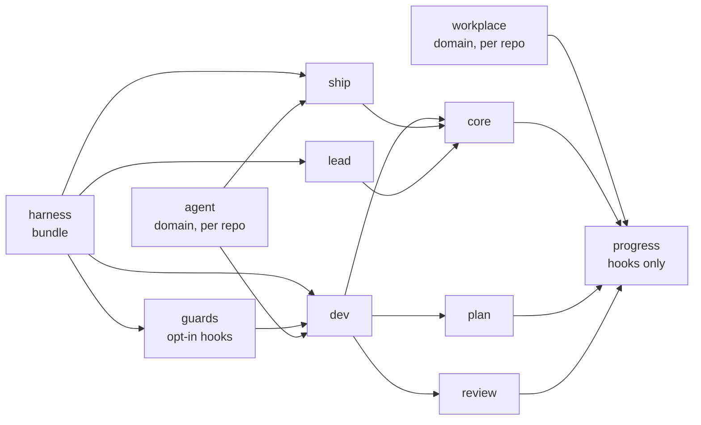
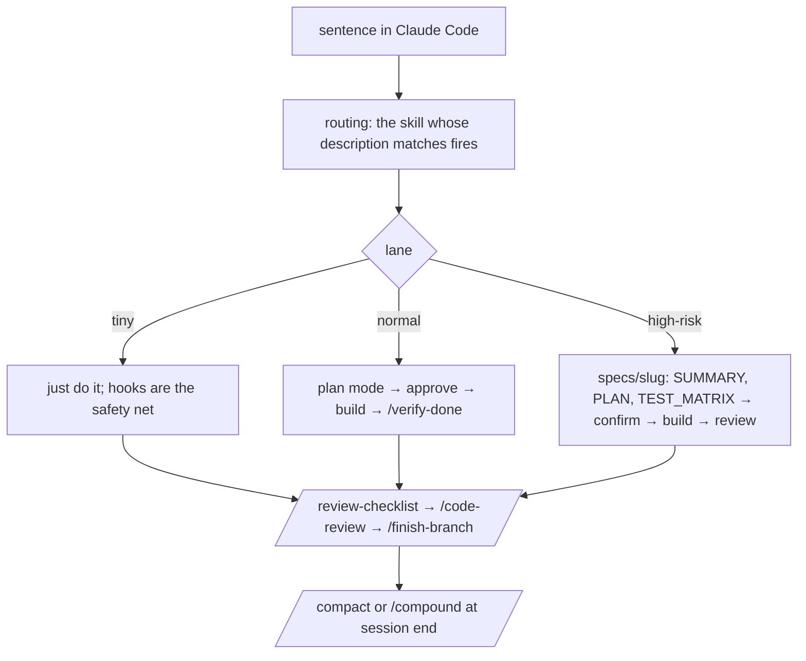

# DESIGN — harness

Why the kit is shaped the way it is: how it is packaged, what each layer does and when it loads, how a request flows, and where each AI-assistant concern lives. Each big decision has a record in [`docs/ddr/`](docs/ddr/README.md). Interactive version of the whole map: [`docs/skill-map.html`](docs/skill-map.html) (regenerate with `scripts/skill-map.py`). To install, see the [README](README.md#quickstart); for everyday use, [`docs/USAGE.md`](docs/USAGE.md).

## 1. Packaging: one marketplace, role plugins, one bundle

From the user's side it is **one install per need**. A role plugin declares its dependencies in `plugin.json` and Claude Code installs them with it.



| Decision | Reason | Record |
|---|---|---|
| Role plugins, not one flat plugin | Every installed skill's description is loaded into every session for routing. A flat plugin with ~50 skills puts all of them in every session, and close descriptions compete for one prompt. A role gets only the skills its work uses | [0001](docs/ddr/0001-role-plugins.md) |
| Dependencies declared and linted | A skill may name another plugin's skill only when that plugin is a dependency; otherwise it writes "(<plugin>, if installed)". `scripts/lint-kit.py` fails the build otherwise, so a role installed alone never points at a missing skill | [0001](docs/ddr/0001-role-plugins.md) |
| Domain plugins (`agent`, `workplace`) outside the bundle | A bundle dependency cannot be disabled. The domain plugins stay off at user scope so core's `repo-profile` hook can enable them per repo, from the repo's own manifests | `plugins/harness/README.md` |
| Commit-blocking hooks beyond the core gates are opt-in (`guards`) | Rails that block commits never arrive with a plain skill install | [0005](docs/ddr/0005-hooks-enforce-the-process.md) |
| Every plugin stays at `1.0.0` until the kit is published | Bumping on every change caused `plugin.json` conflicts across parallel PRs; the commit on `main` identifies the kit | [0002](docs/ddr/0002-versions-stay-1-0-0.md) |
| The team installs from GitLab, GitHub is the mirror | Claude Code clones with the person's own git access, so there is no fixed install path; `/sync-remote` keeps the two in step | [0008](docs/ddr/0008-install-from-gitlab.md) |

Naming: plugin `<role>`; skill a verb-noun matching its directory (`fix-bug`, `review-checklist`), AI-assistant skills `agent-<layer>`; invocation `/<skill>`, or `/<plugin>:<skill>` when two plugins define the same name.

## 2. Layers and when they load

Always-loaded context is the budget. Anything not needed on every task goes into a skill or a reference.

| Layer | Loaded | Lives in | Holds |
|---|---|---|---|
| Global instructions | every session | `global/CLAUDE.md` → `~/.claude/CLAUDE.md` (via `scripts/install.sh`) | principles, lanes, the daily loop |
| Rules | every session, or only for matching `paths:` | `plugins/core/rules/` → `~/.claude/rules/` | git, security, code quality, model cost (always); typescript, testing, app structure, API contract, data access (by path) |
| Skills | on demand, routed by `description` / `when_to_use` | `plugins/<plugin>/skills/<name>/SKILL.md` | a step-by-step workflow with a "Done when" check |
| References | read by a skill when it needs them | `plugins/<plugin>/references/`, `skills/<name>/references/`, `plugins/<pack>/rules/` | detail that would bloat the skill; the agent framework invariants |
| Hooks | on events | `plugins/core/hooks/`, `dev/hooks/` (always on with the role); `ship/hooks/` (release gate); `guards/hooks/` (opt-in) | the checks that must happen rather than be remembered |
| Project workspace | per project | `.claude/` written by `/project-init`, `docs/solutions/`, `specs/` | project docs, memory, lessons, handoffs |

## 3. How a request flows



Three principles run through it, each with its record:

- **Ceremony scales with risk; human interruption scales with ambiguity.** The lane comes from the risk signals; a person is asked only to resolve intent. Auth, data migration, security, external providers, public contracts, weakened validation and `.claude/` config are always high-risk. Full control model: [`HARNESS.md`](HARNESS.md).
- **Opus decides, cheaper models type.** The main session plans, decides and reviews. Code from an approved plan goes to Sonnet, mechanical work to Haiku. A skill whose wrong call is expensive pins `model: opus`; a light one runs on the session's model. [0003](docs/ddr/0003-model-by-role.md)
- **Evidence over claims.** `/verify-done` re-runs checks in the session; the PR's Witness line comes from `run-log`; `/resolve-question` answers facts with a `file:line` citation. [0006](docs/ddr/0006-evidence-over-claims.md)

What the hooks enforce versus what a skill only asks for is the subject of [0005](docs/ddr/0005-hooks-enforce-the-process.md): a skill's text is read once and forgotten under pressure, so what must happen is a hook.

## 4. AI assistant design (`agent`)

Target stack: TypeScript, **CopilotKit v2** in the web client, **AG-UI** as the transport, and **Mastra, LangChainJS or LangGraph** on the agent server, each scaffolded from the vendor's official reference repo. Every skill reads its invariants from `plugins/ai/rules/`; these load only when a skill reads them.

### One skill per layer

```mermaid
flowchart LR
  arch[/agent-architect<br/>interview → ADR → scaffold/] --> feat[/agent-feature<br/>ADR fit + reuse inventory/]
  feat --> tool[/agent-tool<br/>backend tools/]
  feat --> graph[/agent-graph<br/>agents, routing, prompts/]
  feat --> hitl[/agent-hitl<br/>confirm before write/]
  feat --> rag[/agent-rag<br/>retrieval, semantic memory/]
  feat --> fe[/agent-frontend<br/>CopilotKit wiring/]
  fe --> ui[/agent-design-ui<br/>Figma → chat UI/]
  graph & tool --> pr[/agent-prompt-review<br/>prompt and schema diffs/]
  tool & graph & hitl & rag & fe --> verify[/agent-verify-turn<br/>real turn, AG-UI stream/]
  verify --> evals[/agent-evals<br/>dataset, suite, CI gate/]
  evals --> sec[/agent-security<br/>threat model/]
```

### Where each concern lives

| Question | Skill | Rule / reference |
|---|---|---|
| Which architecture for a new assistant? | `/agent-architect greenfield`: product questions first, then an ADR in `docs/adr/` and a scaffold with `.env.example`, a tracing switch and the first eval cases | `skills/agent-architect/references/shapes.md`, `layouts.md` |
| Which models, at what cost? | `/agent-architect` sets three roles in `.env` from the hardest task, volume and budget; a change goes through `/agent-evals compare-models` | [0004](docs/ddr/0004-assistant-models-from-the-problem.md), `references/model-choice.md` |
| A feature in an existing assistant | `/agent-feature`: ADR check, reuse inventory, reuse / extend / new per slice, duplicate check | `skills/agent-feature/references/reuse-inventory.md` |
| A backend tool | `/agent-tool`: Zod schema, identity from trusted context, read vs mutation, retry and audit | `rules/agent-identity-and-tools.md` |
| A frontend tool (runs in the browser) | `/agent-frontend`: `useFrontendTool`, registered only for the agent allowed to call it | `rules/agent-identity-and-tools.md` § Where a tool lives |
| Agent tool or frontend tool? | Data, identity, secrets, audit or writes → agent tool. Browser-only effects → frontend tool. Fetch-then-show → both | same |
| CopilotKit integration | `/agent-frontend`: provider, auth headers, `useAgent`, `useRenderTool`, suggestions, attachments, e2e on recorded AG-UI streams; `/agent-design-ui` for theme and slots | `rules/agui-transport.md` |
| Shared context (page state → agent) | `/agent-frontend`: `useAgentContext`, display-only, never used for authorisation | `/agent-security` covers injection through context |
| Short-term memory (the conversation) | LangGraph checkpointer keyed by `thread_id`; Mastra storage | `rules/langgraph.md` § State, `rules/mastra.md` |
| Long-term memory, retrieval | `/agent-rag`: LangGraph Store or Mastra memory namespaced by the trusted user id; vector store with a server-side tenant filter | `rules/langgraph.md` § Long-term memory |
| Writes that need confirmation | `/agent-hitl`: standard AG-UI interrupt and resume, pending-action record, confirm / cancel / replay | `rules/langgraph.md` § Interrupts, `rules/mastra.md` |
| Prompts and output schemas | `/agent-graph` writes them; `/agent-prompt-review` reads a diff the way the model does | `rules/agent-prompts.md` |
| Evals, including the dataset | `/agent-evals dataset` (JSONL) → `suite` (judged, baseline gate) → `compare-models` | `skills/agent-evals/references/dataset-example.jsonl` |
| Observability | wired at scaffold time; added later with `/agent-evals observability`; read with `/agent-verify-turn prod-trace` | `rules/agent-tracing-privacy.md` |
| Code structure, conventions, responsive | `/agent-architect` scaffold, `/agent-design-ui` narrow-width shots, `/agent-feature` shape check | `rules/agent-code-structure.md` |
| Proving a change works | `/agent-verify-turn local`: drive a real turn and read the event stream | — |
| Security and compliance | `/agent-security`: injection, confused deputy, exfiltration, PII in traces, SOC 2 mapping | `rules/agent-tracing-privacy.md` |

## 5. Quality gates for the kit itself

- `bash scripts/check.sh`: skill lint (frontmatter, dependency check), the routing eval (`eval/triggers/<skill>.json`: three prompts per skill must rank it in the top 3, no model call), the hook tests, and `claude plugin validate` per plugin. CI runs the same script. [0007](docs/ddr/0007-routing-is-tested.md)
- `bash scripts/eval-plugin.sh <plugin>`: behaviour evals with a real model, paid, run before a release or a demo.
- Release, once published: bump `version` in each changed `plugin.json`, merge, `claude plugin tag plugins/<plugin> --push`.
