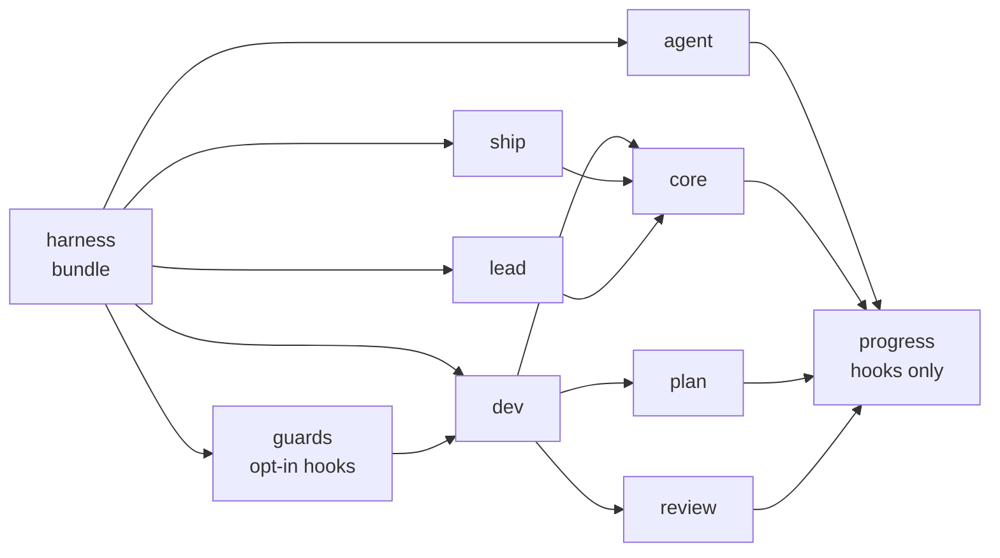
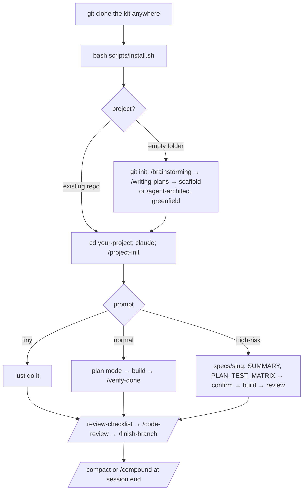

# DESIGN — harness

Interactive version: [`docs/skill-map.html`](docs/skill-map.html) (zoom, click a node for what/when/how, double-click a plugin to see its skills; regenerate with `scripts/skill-map.py`).

How the kit is packaged, what each layer does, and how the AI-assistant skills (`agent`) fit together. To install it, see the README Quickstart. For everyday use, see `docs/USAGE.md`.

---

## 1. Packaging: one marketplace, role plugins, one bundle

From the user's side it is **one install per need**:

- Building an AI assistant: `/plugin install agent@harness`. Claude Code installs the plugins it depends on (`progress`) automatically, and every AI-assistant layer below (architecture, tools, HITL, graph, CopilotKit frontend, evals, tracing, security) is inside `agent`. Its skills never require another role plugin; where one helps, they name it "(dev, if installed)".
- Everything: `/plugin install harness@harness`, a bundle that depends on all nine role plugins.

What `agent` alone does not bring: the general dev loop (`/fix-bug`, `/review-checklist`, `/verify-done`, `/finish-branch`), `/project-init`, and the global rules and `global/CLAUDE.md` that `scripts/install.sh` copies to `~/.claude/`.



Why role plugins rather than one flat plugin:

| Reason | Effect |
|---|---|
| Every installed skill's description is loaded into every session to route prompts | A frontend dev who installs only `agent` gets 10 skill descriptions instead of about 40, so routing gets fewer misfires |
| Dependencies are declared in `plugin.json` and checked by `scripts/lint-kit.py` | A skill can name another plugin's skill only when that plugin is a dependency, so nothing breaks when a role is installed on its own |
| Each plugin has its own version | A change to `agent` ships without bumping the dev or review skills |
| Hooks are opt-in (`guards`) | Guard rails that block commits never arrive with a plain skill install |

**Naming conventions**

- Plugin: `<role>`, one role per plugin.
- Skill: a verb-noun or noun name that matches its directory, e.g. `fix-bug` or `review-checklist`. AI-assistant skills are named `agent-<layer>`.
- Invocation: `/<skill>`, or `/<plugin>:<skill>` when two plugins define the same name.

## 2. Layers

| Layer | Loaded | Lives in | Holds |
|---|---|---|---|
| Global instructions | every session | `global/CLAUDE.md` → `~/.claude/CLAUDE.md` | principles, lanes, the daily loop |
| Rules | every session (or by `paths:`) | `plugins/core/rules/` → `~/.claude/rules/` | git, security, code quality, typescript, testing |
| Skills | on demand, routed by `description` / `when_to_use` | `plugins/<plugin>/skills/<name>/SKILL.md` | a step-by-step workflow with a "Done when" check |
| References | read by a skill when needed | `plugins/<plugin>/references/`, `skills/<name>/references/` | detail that would bloat the skill |
| Hooks | on events, opt-in | `plugins/guards/hooks/` | risk gate, commit gate, handoff, breadcrumbs |
| Project workspace | per project | `.claude/` written by `/project-init` | project docs, memory, project rules |

Always-loaded context is the budget. Anything that is not needed on every task goes into a skill or a reference.

## 3. Workflow



The Auto-Coordinator in `global/CLAUDE.md` picks the lane. The full routing logic is in `dev:coordinator`.

## 4. AI assistant design (`agent`)

Target stack: TypeScript, **CopilotKit v2** in the web client, **AG-UI** as the transport, and **LangChainJS / LangGraph** on the agent server. Every skill reads its invariants from `plugins/agent/rules/`. These rules load only when a skill reads them, so they cost nothing in other repos.

### Skill per layer

```mermaid
flowchart LR
  arch[/agent-architect<br/>interview → ADR → scaffold/] --> feat[/agent-feature<br/>ADR fit + reuse inventory/]
  feat --> tool[/agent-tool<br/>backend tools/]
  feat --> graph[/agent-graph<br/>agents, routing, prompts/]
  feat --> hitl[/agent-hitl<br/>confirm before write/]
  feat --> fe[/agent-frontend<br/>CopilotKit wiring/]
  fe --> ui[/agent-design-ui<br/>Figma → chat UI/]
  tool & graph & hitl & fe --> verify[/agent-verify-turn<br/>real turn, AG-UI stream/]
  verify --> evals[/agent-evals<br/>dataset, suite, CI gate/]
  evals --> sec[/agent-security<br/>threat model/]
```

### Where each concern lives

| Question | Skill | Rule / reference |
|---|---|---|
| Starting a new assistant: which architecture? | `/agent-architect greenfield` writes an ADR to `docs/adr/` and scaffolds the repo, including `.env.example`, a tracing switch and the first eval cases | `plugins/agent/skills/agent-architect/references/shapes.md`, `layouts.md` |
| Adding a feature to an existing assistant | `/agent-feature`: checks the ADR, takes a reuse inventory, and decides reuse / extend / new for each slice | `plugins/agent/skills/agent-feature/references/reuse-inventory.md` |
| Defining a backend agent tool | `/agent-tool`: Zod schema, identity from trusted context, read vs mutation, retry and audit | `plugins/agent/rules/agent-identity-and-tools.md` |
| Defining a frontend tool, which runs in the browser | `/agent-frontend`: `useFrontendTool`, registered only for the agent allowed to call it | `plugins/agent/rules/agent-identity-and-tools.md` § Where a tool lives |
| Agent tool or frontend tool? | Data, identity, secrets, audit or writes → agent tool. Browser-only effects (navigate, open a panel, fill a form) → frontend tool. Fetch-then-show → both | `plugins/agent/rules/agent-identity-and-tools.md` § Where a tool lives |
| Integrating CopilotKit | `/agent-frontend`: provider, auth headers, `useAgent`, `useRenderTool`, and e2e tests against recorded AG-UI streams. `/agent-design-ui` handles the theme and slots | `plugins/agent/rules/agui-transport.md` |
| Suggestions | `/agent-frontend`: `useConfigureSuggestions`, served by the backend and limited to tools that exist | — |
| Shared context (page state → agent) | `/agent-frontend`: `useAgentContext`, memoised. It is display-only and never used for authorisation | `/agent-security` covers injection through context |
| Short-term memory (the conversation) | LangGraph checkpointer keyed by `thread_id` | `plugins/agent/rules/langgraph.md` § State |
| Long-term memory (across threads) | LangGraph Store, namespaced by the trusted user id | `plugins/agent/rules/langgraph.md` § Long-term memory |
| Writes that need user confirmation | `/agent-hitl`: interrupt contract, pending-action record, resume | `plugins/agent/rules/langgraph.md` § Interrupts |
| Evaluating prompts, including the dataset | `/agent-evals dataset` (JSONL, example `plugins/agent/skills/agent-evals/references/dataset-example.jsonl`) → `suite` → `compare-models` | `plugins/agent/rules/agent-prompts.md` |
| Observability | Wired by `/agent-architect` at scaffold time; added to an existing repo with `/agent-evals observability`; read with `/agent-verify-turn prod-trace` | `plugins/agent/rules/agent-tracing-privacy.md` |
| Code structure, conventions, responsive | `/agent-architect` scaffold, `/agent-design-ui` build and narrow-width shots, `/agent-feature` duplicate + shape check | `plugins/agent/rules/agent-code-structure.md` |
| ERD from a design | `/agent-architect` writes `docs/erd.md` before the schema | `plugins/agent/skills/agent-architect/references/data-model.md` |
| Proving a change works | `/agent-verify-turn local`: drive a real turn and read the event stream | — |
| Security and compliance | `/agent-security` | `plugins/agent/rules/agent-tracing-privacy.md` |

## 5. Quality gates for the kit itself

- `bash scripts/check.sh`: skill lint (frontmatter, dependency check), trigger eval (`eval/triggers/<skill>.json`, 3 prompts per skill must rank it in the top 3), and `claude plugin validate` per plugin.
- `bash scripts/eval-plugin.sh <plugin>`: behaviour evals with a real model. These are paid and not part of `check.sh`.
- Release: bump `version` in each changed `plugin.json`, merge, then run `claude plugin tag plugins/<plugin> --push`.
