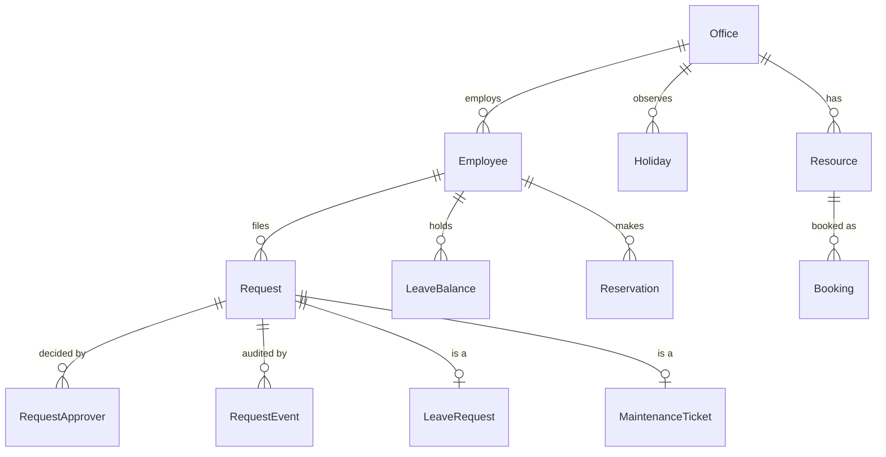

# Workplace starter domain model

A starting point for `/domain-model` and `/db-change`; rename to the repo's terms. Every owned table carries the tenant key (`org_id`) when the app serves more than one company.

| Entity | Key fields | Notes |
|--------|-----------|-------|
| Employee | id, org_id, user_id, office_id, manager_id, status (active / deactivated) | Personal fields per `invariants.md` § 7 |
| Office | id, name, time_zone, working_hours | The business time zone lives here, not in code |
| Holiday | office_id, date (date-only), kind (holiday / make-up working day) | Per office and year |
| Request | id, type, requester_id, filed_by_id, status, created_at | One row per request of any type |
| RequestApprover | request_id, approver_id, decision, decided_at | Approver membership is checked here on every decision |
| RequestEvent | request_id, actor_id, action, note, occurred_at | Audit row per transition |
| LeaveRequest | request_id, leave_type, slots (start, end), days_charged | `days_charged` frozen at approve |
| LeaveBalance | employee_id, leave_type, year, allowance, carried_over | Used = sum of approved; pending held separately |
| Resource | id, office_id, kind (room, desk, vehicle), capacity | Deleting one checks live bookings |
| Booking | id, resource_id, requester_id, start, end, status | Overlap guarded by a DB constraint or a locked transaction |
| Reservation | id, employee_id, office_id, date, items (lunch, breakfast, vegetarian) | Cutoff per office, enforced on the server |
| MaintenanceTicket | request_id, scope_id, location, processing_by | `processing_by` set when work starts |
| Notification | id, record_id, event, recipient_id, channel, sent_at, error | Unique on (record_id, event, recipient_id) for idempotency |

